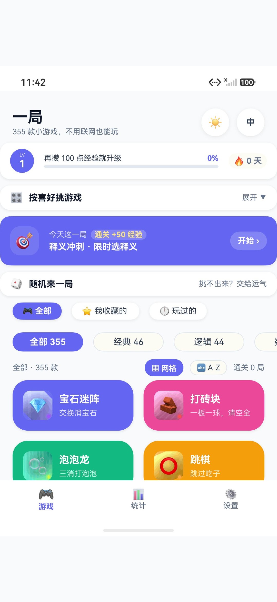
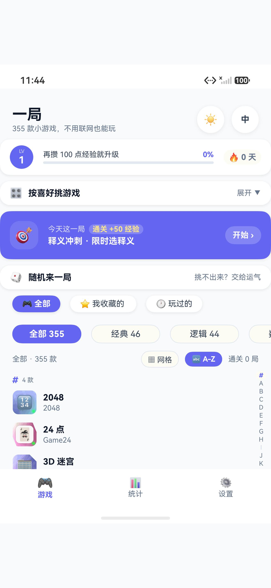
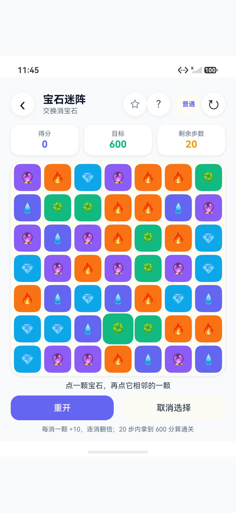
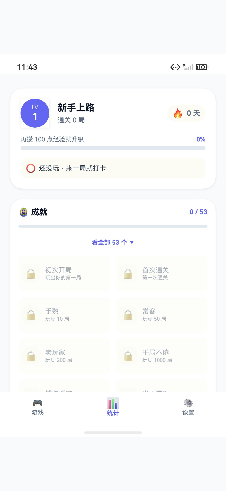

# One More · 一局

<p align="center">
  
  
  
  
</p>

<p align="center">
  <b>355 款小游戏，不用联网也能玩。</b><br>
  碎片时间，来一局。
</p>

---

## 这是什么

**One More** 是一套为 HarmonyOS（鸿蒙）原生开发的**单机小游戏合集** ——
355 款游戏，覆盖数字、逻辑、文字、记忆、反应、棋类六大类型，
全部**离线运行**，**不采集任何个人信息**，**没有广告、没有内购**。

一款用 ArkTS / ArkUI 从零写出的应用，也是我第一次把「想法 → 代码 → 上架」这条路完整走完。

## 特性

| | |
|---|---|
| 🎮 **355 款游戏** | 数字 / 逻辑 / 文字 / 记忆 / 反应 / 棋类，一局一个 |
| 📴 **完全离线** | 不联网也能玩；网络权限只用于同一 Wi-Fi 下的局域网对战 |
| 🌍 **12 种语言** | 简体/繁体中文、英、日、韩、法、德、俄、西、葡、意、阿拉伯 |
| 🔒 **零采集** | 不收集、不上传任何信息；游戏记录只存在你自己的手机上 |
| 🌗 **深色模式** | 跟随系统 / 手动切换，运行时切换不重启 |
| 🏆 **成长系统** | 经验值、等级、连续天数、成就徽章、355 款通关进度 |
| 📊 **统计** | 每款游戏的游玩次数、最佳成绩、完成度 |

## 技术栈

- **HarmonyOS Next**（minAPIVersion `50000012` / API 12）
- **ArkTS + ArkUI**（Stage 模型，声明式 UI）
- **纯原生**，无第三方 UI 框架
- **Game Service Kit**（华为游戏服务：初始化 + 防沉迷合规）

## 项目结构

```
entry/src/main/ets/
├── entryability/      应用入口（含游戏服务初始化）
├── core/              核心层
│   ├── GameRegistry   355 款游戏的元数据注册表
│   ├── ProgressStore  进度/统计持久化
│   ├── I18n           12 语言字典 + 系统语言检测
│   ├── AppClock       全局前台时钟（切后台暂停计时）
│   └── About          版本信息
├── games/             355 个游戏实现，一款一个文件
├── components/        通用 UI 组件（卡片、格子、进度条…）
└── pages/             页面（首页 / 统计 / 设置 / 游戏宿主）
```

> **为什么 355 个游戏文件而不是一个巨型 switch？**
> 每款游戏独立文件 ⇒ 编译期就能做静态类型检查、单文件定位问题、按需增删。
> 入口统一由 `GameHost.ets` 分发（356 个静态 import，无动态加载）。

## 构建

```bash
# 需要 DevEco Studio + HarmonyOS SDK
cd yiju
bash build.sh assembleHap     # 快速构建（~10s）
bash build.sh assembleApp     # 出正式包（~6min，需要签名配置）
```

**签名配置**：`build-profile.json5` 里需要指向你自己的 `.p12 / .p7b / .cer`。
本仓库**不包含任何签名证书**（见 `.gitignore`）。

## 一些数字

| | |
|---|---|
| 游戏款数 | **355** |
| ArkTS 源码 | **384 个 `.ets` 文件** |
| 源码体积 | ≈ 12 MB |
| 支持语言 | 12 |
| 第三方运行时依赖 | 0 |
| 广告 / 内购 / 用户追踪 | 0 |

## 关于「355」

不是凑数 —— 每一款都是真的能玩、有明确规则、有胜负判定的游戏。
从经典的数独、扫雷、五子棋，到自制的路径合并、特征矩阵记忆、齿轮传动方向……

**每款游戏都写了独立的规则、生成器、校验逻辑和本地化。**

## 许可

代码以 **MIT License** 开源（见 [LICENSE](LICENSE)）。
游戏名称与图标版权归作者所有。

## 作者

**Andrew Oscar（王子乐）** — 南方科技大学 2026 级

- 这个项目：从 0 到上架，一个人 + 一个 AI 搭档（拾海）
- 其他：Kaggle / 数据竞赛 / 鸿蒙应用开发

---

<p align="center">
  <i>「碎片时间，来一局。」</i>
</p>
