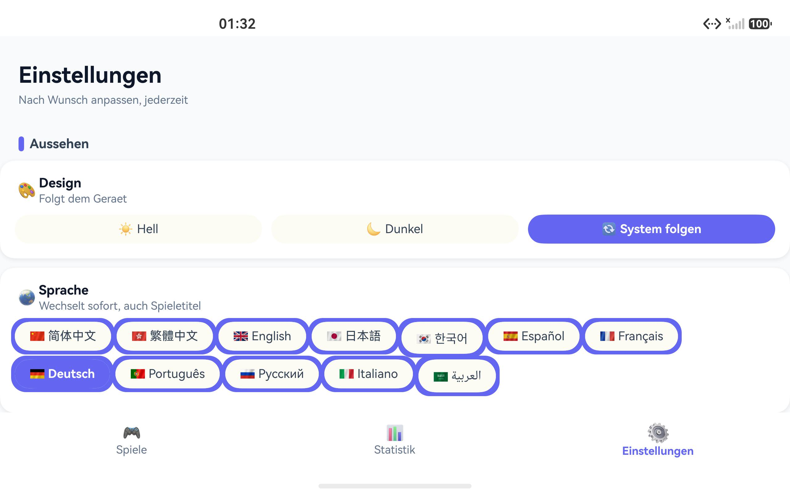
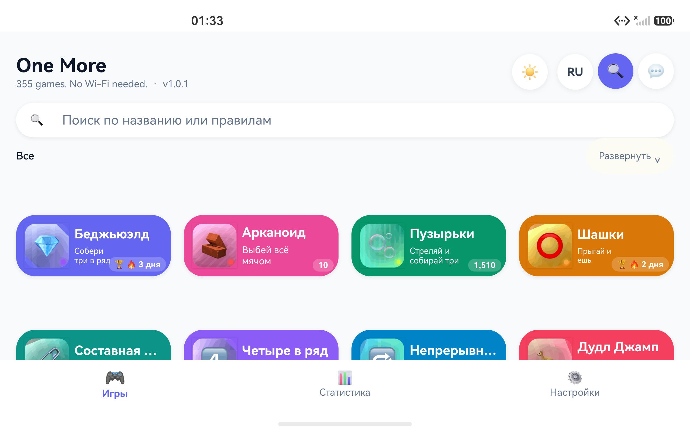
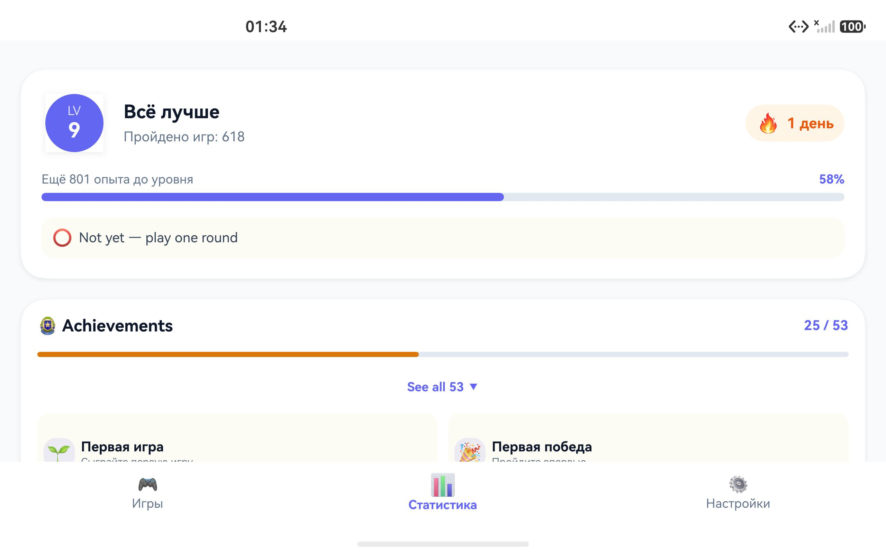
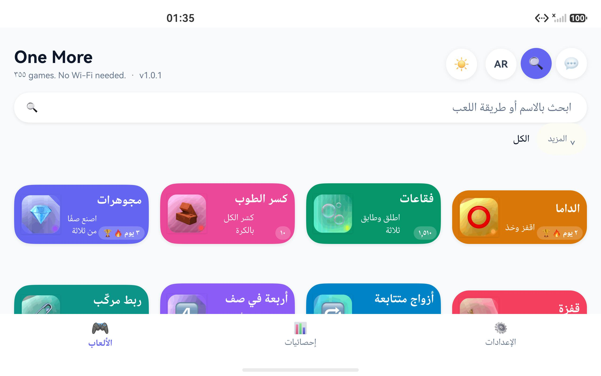
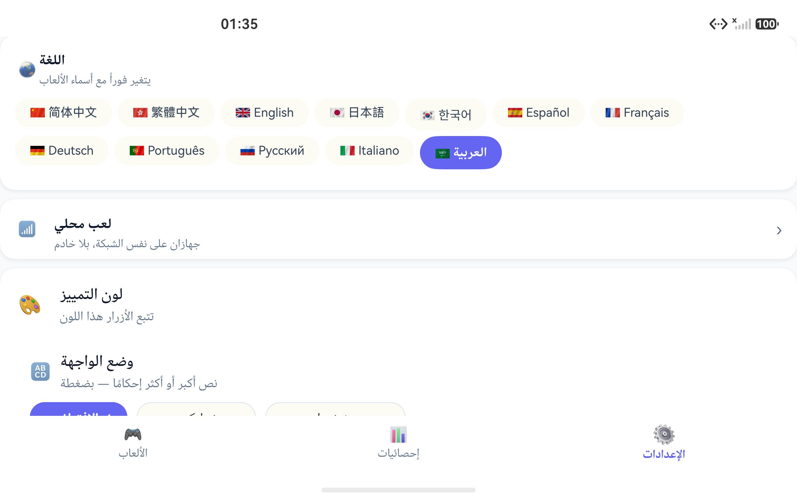

# 12 语言真机验收（2026-11-08 凌晨 · hdc）

> 设备：`127.0.0.1:5557`，**2560×1600 平板/桌面类**（不是手机）。
> 只读：切语言是 app 内操作；**未装包、未清数据**。收尾已切回**简体中文**。
> 截图见 `_巡检记录/shots-12lang/`。

---

## 结论速览

| 语言 | 位置 | 长词溢出 | RTL | 其它 |
|---|---|---|---|---|
| **德语** | 设置页 | **无**（全部放得下） | — | 发现文案拼写错误「Buttond」 |
| **俄语** | 首页 | **2 处**：卡片标题被截断 | — | — |
| **俄语** | 统计页 | 无（文字都放得下） | — | **3 处英文泄漏** |
| **阿拉伯语** | 首页 + 设置 | 无 | **完全未生效** | 角标数字仍是西文 |

**三条硬结论**：
1. 德语在**这块宽屏上零溢出** —— 但**不能据此结案**：设备是 2560×1600 桌面布局，不是我静态推算的 360vp 手机。
2. **俄语真溢出 2 处**（卡片标题）。
3. 发现了**两个比溢出更严重的问题**：统计页英文泄漏（89 处同模式）、我上一轮引入的「12 个芯片同时高亮」。

---

## ① 德语 · 设置页（`10-settings-de.jpeg` / `11-settings-de-lower.jpeg`）



逐项核对（全部**无省略号、无截断**）：

| 位置 | 德语实际文案 | 判定 |
|---|---|---|
| 标题 | `Einstellungen` / `Nach Wunsch anpassen, jederzeit` | ✅ |
| 外观 | `Aussehen` | ✅ |
| 外观模式三胶囊 | `Hell` / `Dunkel` / `System folgen` | ✅ 三个都完整 |
| 语言 | `Sprache` / `Wechselt sofort, auch Spieltitel` | ✅ |
| 12 个语言芯片 | 全部完整（含 `Português` `Русский` `العربية`） | ✅ |
| 局域网 | `LAN-Spiel` / `Zwei Geräte im selben WLAN, kein Server` | ✅ |
| 主题色 | `Akzentfarbe` / `Buttond und Akzente folgen dieser Farbe` | ⚠️ **拼写错误「Buttond」**（应为 `Buttons`） |
| 界面模式三按钮 | `Standard ✓ / Standardgröße und -abstand`、`Große Schrift / Größere Schrift, Buttons und Abstände`、`Kompakt / Kompakter, mehr pro Bildschirm` | ✅ 都完整，**两行也放得下** |

**与静态推算的差异**：我的静态报告预测「`游戏时屏幕常亮`（德 20 字符）会越线、`Anzeigemodus` 三按钮会挤」——
**真机全否**。原因是设备宽度 2560px（≈4 列布局），卡片可用宽远超我按 360vp 手机算的 174vp。
⇒ **静态推算在宽屏上明显偏保守**（这一点对后续判断很重要：不要拿宽屏截图给手机结案）。

> ⚠️ 另外注意：截图上**12 个芯片全带紫色描边** —— 这不是设计，是 bug，见 §④。

---

## ② 俄语 · 首页（`20-home-ru.jpeg`）—— **2 处真溢出**



| 卡片 | 显示 | 判定 |
|---|---|---|
| Беджьюэлд / Арканоид / Пузырьки / Шашки | 完整 | ✅ |
| **Составная …** | **被省略号截断** | 🔴 **真溢出** |
| **Непрерывн…** | **被省略号截断** | 🔴 **真溢出** |
| Дулд Джамп、Четыре в ряд | 完整 | ✅ |

**为什么溢出**：卡片是 4 列布局（2560px 宽），每卡约 500px；俄语游戏名比中文长 2~3 倍，
而标题是 `maxLines(1) + Ellipsis`（我上一轮加的兜底）⇒ 兜住了不破版，但**名字读不全**。
**一句话修法**：宽屏下把这张卡改成 3 列，或标题允许 2 行（与「大字模式」同一套判断）。

**副标题**（「Собери три в ряд」等）折成 2 行，属于设计允许（`maxLines(2/3)`），不算 bug。

---

## ③ 俄语 · 统计页（`24-stats-ru-try2.jpeg`）—— **3 处英文泄漏**



界面主体是俄语（`Всё лучше` / `Пройдено игр: 618` / `Ещё 801 опыта до уровня` / `Первая игра` / `Первая победа`），
但有 **3 处英文**：

| 位置 | 显示 | 应为 |
|---|---|---|
| 打卡条 | `⭕ Not yet — play one round` | `⭕ Пока пусто — сыграйте` |
| 成就标题 | `🏅 Achievements` | `🏅 Достижения` |
| 展开按钮 | `See all 53 ▼` | `Показать все 53` |

**根因（已定位到代码）**：**双重取词** `this.t(TG('中文'), 'English')`：

```ts
// components/StatsTab.ets:959
Text(this.t(TG('🏅 成就'), '🏅 Achievements'))
//   ↑ TG() 已经把中文翻成俄语「🏅 Достижения」
//     然后 t() 又拿【俄语】当 key 去查 EXTRA ⇒ 查不到 ⇒ 退第二个参数（英文）

// components/Common.ets:787
this.t(TG('还没玩 · 来一局就打卡'), 'Not yet — play one round')
// components/StatsTab.ets:984/1004
this.tn(TG('看全部 {n} 个'), 'See all {n}', n)
```

**这不是 3 处，是一个系统性模式**：全项目 `this.t(TG(...))` / `this.tn(TG(...))` 共 **89 处**
（`StatsTab / Common / SettingsTab / GamesTab / GuidePage / GameHost / Splash / LanLobby` 八个文件）。
⇒ **10 种非英语语言下，这 89 处全部退英文**，而中文/英文下看起来完全正常 —— 静态检查很难发现。

**一句话修法**：`t(TG(x), y)` 改成 `TG(x)`（TG 已经做了 12 语言查表 + 缺项兜底）；
若那个 key 只在 EXTRA 不在 DICT，则改成 `t(x, y)`。

---

## ④ 阿拉伯语（`30-settings-ar.jpeg` / `32-home-ar2.jpeg`）—— **RTL 完全未生效**




对照 RTL 应有的镜像，逐条核对：

| 位置 | 现象 | 应为 |
|---|---|---|
| 顶栏「One More」 | 仍在**左** | 右 |
| 搜索框图标 | 仍在**左**（文字在右） | 图标在右 |
| 「المزيد ∨」 | 仍在**右** | 左 |
| 卡片排列 | 仍**从左到右** | 从右到左 |
| 底部标签栏 | 游戏/统计/设置 仍**左→右** | 镜像 |
| 设置页行 | 图标在左、文字在右 | 图标在右 |
| `›` 箭头 | 仍朝**右** | 朝左 `‹` |
| 语言芯片顺序 | 仍以「简体中文」打头（左） | 阿拉伯语应在右起第 1 |

**与静态审计一致**：我当时报的 P0-3「全项目 `.direction()` 0 处、`isRTL()` 只有 2 处且只改 textAlign」
——**真机完全证实**。文字本身右对齐（阿拉伯文自身的书写方向），但**布局骨架仍是 LTR**。

**另外**：卡片角标数字是**西文**（`1,510` / `3 يوم` / `10`），阿拉伯语该用 `١٬٥١٠`。
`Digits()` 只覆盖了 `L()/TN()` 出口，卡片角标这条链路没走。

---

## ⑤ 【新】我上一轮引入的回归：12 个芯片**同时**高亮

**证据**：`10-settings-de.jpeg` 里 12 个语言芯片**全部**带 4px 紫色描边；
切回中文后（`41-back-zh.jpeg`）**全部消失** —— 说明它只在「有焦点」时出现。

**根因**：语言芯片是**共享 @Builder**（`languageChip(code, ...)`），
而我上一轮按「`.onClick` 所在行号」生成的焦点 id 是 `'S653'` —— **12 个实例共用同一个 id**：

```ts
.focusable(Tv.on())
.onFocus(() => { this.tvFocus = 'S653'; })     // ← 12 个芯片都写同一个值
.outline(Tv.focusOutline(this.tvFocus === 'S653'))   // ← 于是 12 个都判定"我有焦点"
```

⇒ 点任意一个芯片，`tvFocus === 'S653'` 对所有 12 个都成立 ⇒ **12 个描边同时亮**。
**受影响的不止语言芯片**：所有共享 @Builder 的焦点组（主题色 6 格、界面模式 3 个、主题模式 3 个、
navRow 6 行、tag chip）都是同一个问题。

**一句话修法**：焦点 id 必须**按实例**唯一 —— `'S653-' + code`、`'S1113-' + o.id`、
`'S1221-' + cfg.storeKey`。

---

## 附：设备侧异常（与代码无关）

- 采集期间 app **三次被切到后台/桌面**（01:33 / 01:34 / 01:36），每次都在我切页后几秒内。
- 查 `/data/log/faultlog/faultlogger/`：**没有 01:3x 的本 app 崩溃记录**（最近一条 `appfreeze` 是 20:31，5 小时前）。
- ⇒ 是**别的进程/自动化在抢设备**（多次 `aa start` 后又消失），不是本 app 崩溃。
- 补记：`appfreeze-com.andrewoscar.onemore-20261107203140.log` 存在一份 20:31 的冻结记录，值得另查。

---

## 与静态推算的差异总表

| 我静态报告的预测（360vp 手机） | 真机（2560×1600） | 差异原因 |
|---|---|---|
| 设置页「游戏时屏幕常亮」德语越线 | **没越线** | 宽屏可用宽 4 倍于手机 |
| 界面模式三按钮德语会挤 | **没挤**（两行都放得下） | 同上 |
| 结算弹窗「返回列表」法/西超 25% | 未验（本轮没进结算） | — |
| 首页卡片副标题德语 143vp vs 30vp | 俄语标题**确实被截** | 卡宽 500px 仍不够俄语长名 |
| RTL 完全未接 | **完全证实** | — |

**结论**：**静态推算用于「找不到候选」有效，用于「判定会溢出」在宽屏上偏保守**；
真正要判定手机，必须在 **360vp 宽度**下跑（这块设备给不了）。

---

## 建议下一步（按性价比）

1. **修 `t(TG(...))` 双重取词**（89 处）—— 影响面最大，且中文/英文下完全不可见。
2. **修焦点 id 唯一性**（上一轮回归，宽屏/电视上很显眼）。
3. **RTL 接上**（`.direction()` 或切语言时 `setAppPreferredLanguage`）。
4. 俄语长游戏名：宽屏改 3 列或标题 2 行。
5. 德语 `Buttond` → `Buttons`（1 条字典）。
